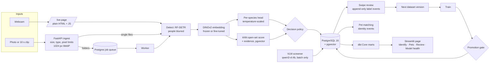
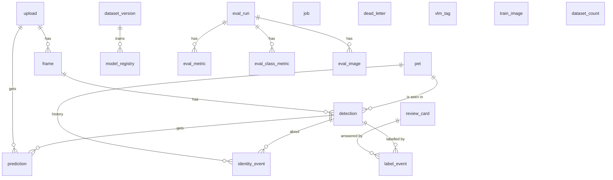
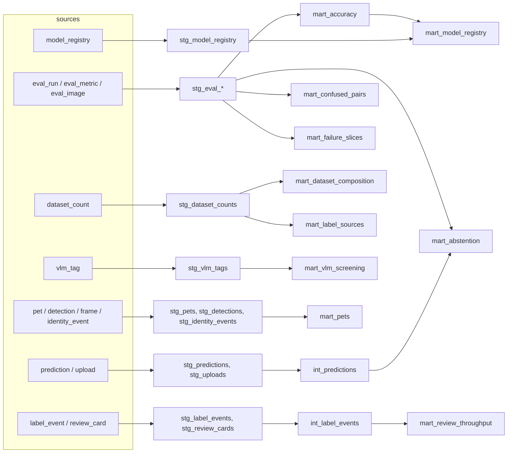

# PetLens

**A fully local pet breed recogniser that knows when it doesn't know, and gets better from a fast human review loop.**

PetLens takes a photo, a 10-second clip or a live webcam feed, finds each cat and dog, and says which breed it *looks most like*, with a calibrated confidence. Most cats have no breed, so "domestic cat, no clear breed" is a trained answer, and "not sure" is a valid one. Everything runs on one Windows laptop with an RTX 2060: no cloud services, no paid APIs, €0 to build and run.

```bash
make up && make demo      # Postgres in Docker, a seeded demo database, the page opens
```

---

## What makes it more than a classifier

- **It abstains on purpose.** A kNN distance to the training set flags photos unlike anything seen, and a decision policy tuned on held-out data chooses between *accept*, *no clear breed* and *review*. The number it is tuned against is the **false breed claim rate**: how often an ordinary cat gets called a pedigree.
- **Evidence, not just a label.** Every answer shows the training photos it looks most like (pgvector), and look-alike pairs (Ragdoll and Birman) are shown side by side.
- **A swipe review loop.** I swipe answers right or wrong. Every label is an append-only event that keeps its origin, and only reviewed labels feed the next dataset version.
- **Promotion is earned.** A new model replaces the champion only if a paired bootstrap on a frozen golden set and on sources it never trained on says it is better, no breed's recall falls by more than 10 points, and false breed claims don't rise.
- **A local VLM with a narrow, measured job.** `qwen3-vl:4b` (Ollama) tags dataset photos (real photo or drawing, whole animal, kitten, blurry, several animals). Its tags only keep weak web photos out of training, and they are scored against my reviews with Cohen's kappa.
- **Pet profiles.** Uploads are matched to pets seen before by appearance; I can name, merge and split them, and every change is an identity event.
- **Data engineering you can audit.** dbt Core marts with enforced contracts, snapshots and unit tests feed the Model health tab; the app never computes a dashboard number itself.

## Results

The numbers below come from the code and the dbt marts in this repo. The full, current set for the model the app serves is generated into [MODEL_CARD.md](MODEL_CARD.md) by `make cards`.

| What | Result | Where it comes from |
| --- | --- | --- |
| False breed claims on ordinary cats | 0.6% of 174 domestic test cats (target: 10% or lower) | Step 4, `mart_accuracy` |
| Photo analysis, RTX 2060 | about 0.1 s per photo, 0.7 s for a 6-frame clip | Step 5, `make analyse` timings |
| Live camera | end-to-end FPS measured on the page (frame out, answer back) | `/live` page, `LiveSession.fps` |
| Model promotion | paired bootstrap (10,000 resamples) on the golden set and unseen sources | `make gate`, `gate.md` per run |
| Backbones compared | frozen ViT-S/14 and ViT-B/14, and both with the last 2 blocks fine-tuned | `docs/results/ablation-<version>.md` |
| VLM screener | agreement with my reviews (Cohen's kappa) and effect on label noise | `make vlm-report` |
| VLM naming breeds directly | accuracy of `qwen3-vl:4b` naming the breed vs. the trained heads | `make vlm-breeds` |
| Pet re-ID | pairwise precision and recall on my labelled photos, with failures listed | `docs/results/pets-reid.md` |

## Architecture



The camera and the VLM never share the 6 GB of VRAM: the camera refuses frames while a VLM job runs, and the VLM job waits while the camera page is open.

## Data model



`label_event` and `identity_event` are append-only (a trigger refuses updates and deletes): the current label or pet of anything is derived from its events, so every change can be audited and replayed. Migrations are Alembic (`0001` to `0008`), and a test checks the tables against the Pydantic contracts the API uses.

## dbt lineage



Snapshots (`snap_label_status`, `snap_pet_assignment`, `snap_pets`) keep the history of labels and pet assignments. `dbt build` runs in CI against fixtures, with contracts enforced and unit tests on the trickier marts.

## Stack

| Layer | Technology |
| --- | --- |
| Detection | RF-DETR (Apache 2.0 sizes) |
| Classification | DINOv2 ViT-S/14 and ViT-B/14 (timm), linear and MLP heads, partial fine-tuning in fp16, PyTorch CUDA |
| Image and video | Pillow (WebP), PyAV |
| Local VLM | Ollama, `qwen3-vl:4b` with JSON-schema output validated by Pydantic |
| API | FastAPI, Pydantic v2 |
| Storage | PostgreSQL 16 + pgvector, SQLAlchemy 2, Alembic, a Postgres-backed job queue |
| Transformation | dbt Core + dbt-postgres: incremental models, snapshots, contracts, unit tests |
| UI | Streamlit, plus a plain HTML and JavaScript live camera page |
| Quality | pytest, Ruff, mypy (strict), GitHub Actions with Postgres and a dbt build |
| Tooling | uv, Docker (Postgres only), GNU Make |

## Try it

### The demo (no dataset, no GPU)

Needs [uv](https://docs.astral.sh/uv/), Docker and GNU Make.

```bash
git clone https://github.com/mohamed-mnasri/petlens.git
cd petlens
make up      # installs packages, starts Postgres + pgvector, migrates
make demo    # seeds a separate petlens_demo database, builds the marts, opens the page
```

The demo never touches the main database. It fills `petlens_demo` with a small synthetic evaluation, a champion model entry, review answers and two made-up pets, builds the dbt marts on it, then starts the API on port 8100 and the page on port 8601. Model health, Pets, Review history and Batch jobs all work; identifying a photo says there is no trained model until you train one.

### The full pipeline

```bash
cp .env.example .env          # set DATA_DIR (D:/petlens-data on my machine)
make install-ml               # torch, timm, RF-DETR
make data                     # Oxford-IIIT Pet + Commons, grouped splits, manifest
make data-quality             # flag weak photos
make embed train              # DINOv2 embeddings, heads, calibration, policy
make golden register promote  # freeze the golden set, record the run, make it champion
make db-index                 # evidence vectors into pgvector
make api                      # http://127.0.0.1:8000 (live camera at /live)
make ui                       # http://127.0.0.1:8501
make eval dbt                 # metrics into Postgres, then the marts
make cards                    # MODEL_CARD.md, DATASET_CARD.md, ATTRIBUTION.md
```

Optional: `make finetune`, `make ablation`, `make vlm-pull vlm-screen vlm-report`, `make pets-eval`. Every target is listed with a comment in the [Makefile](Makefile).

`make check` runs Ruff, mypy and pytest. Tests that need Postgres run when `DATABASE_URL` is set.

## Data

- **Training:** the [Oxford-IIIT Pet Dataset](https://www.robots.ox.ac.uk/~vgg/data/pets/) (12 cat and 25 dog breeds, CC BY-SA 4.0), plus openly licensed [Wikimedia Commons](https://commons.wikimedia.org/) and Openverse photos with author and licence recorded per file.
- **Held out:** domestic cats (to count false breed claims), breeds the model doesn't know (to check it says so), sources it never trained on, and a frozen golden set of hand-checked photos.
- **Never committed:** images, weights and footage. The manifests are committed, so every dataset version can be rebuilt.

See [DATASET_CARD.md](DATASET_CARD.md), [ATTRIBUTION.md](ATTRIBUTION.md) and [docs/DATASET.md](docs/DATASET.md).

## Decisions

The main design decisions and their trade-offs are recorded as ADRs in [docs/adr](docs/adr): local-first on Windows, Postgres over DuckDB, the job queue in Postgres, a DINOv2 linear probe before fine-tuning, the VLM as a screener rather than a labeller, appearance grouping instead of a tracker, the paired promotion gate, and the live page as plain HTML.

## Limitations

- "Looks like" is a visual judgement, not ancestry. Mixed-breed dogs get the breed they resemble most.
- 12 cat breeds and 25 dog breeds. Anything else should come back as "not sure", and sometimes won't.
- Look-alike pairs (Ragdoll and Birman, British Shorthair and Russian Blue) cause most of the mistakes.
- Webcam frames in poor light are harder than photos; the live page averages over 5 frames to steady the answer.
- Some breeds have few openly licensed photos, so their numbers have wide intervals.
- Pet matching is by appearance only: two very similar cats can be merged by mistake, which is why merge and split are one click.

## Responsible use

Breed identification from a photo is uncertain, even for experts. PetLens shows top-3 suggestions with calibrated probabilities and abstains when unsure. It should **not** be used for adoption, sale, legal, veterinary or insurance decisions. People in frames are blurred before anything is stored, and the live camera keeps at most one frame every 10 seconds while an animal is in view.

## Project docs

- [docs/SPEC.md](docs/SPEC.md): the full design
- [docs/PLAN.md](docs/PLAN.md): the build plan, step by step, with implementation notes
- [docs/WRITEUP.md](docs/WRITEUP.md): what I built, what worked, what didn't
- [MODEL_CARD.md](MODEL_CARD.md) and [DATASET_CARD.md](DATASET_CARD.md)

## Licence

To be decided before the repository is made public. Third-party models and datasets keep their own licences.
